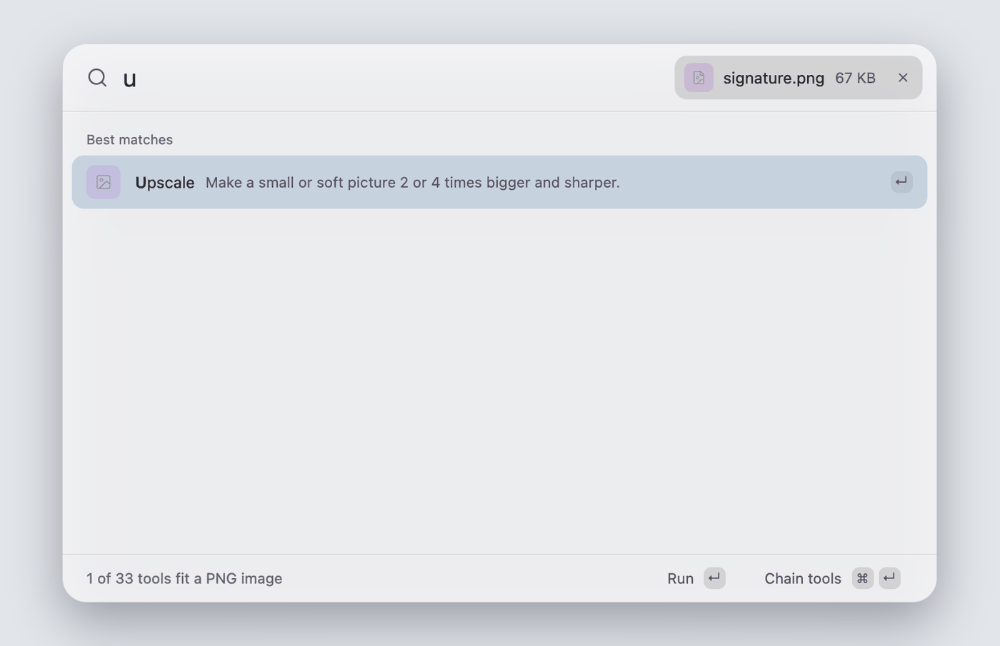
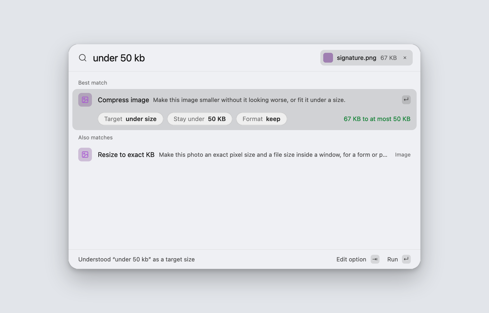
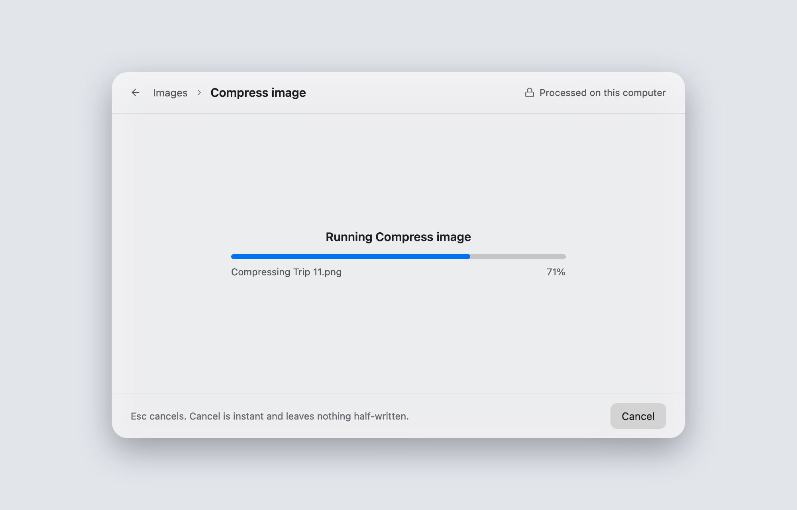
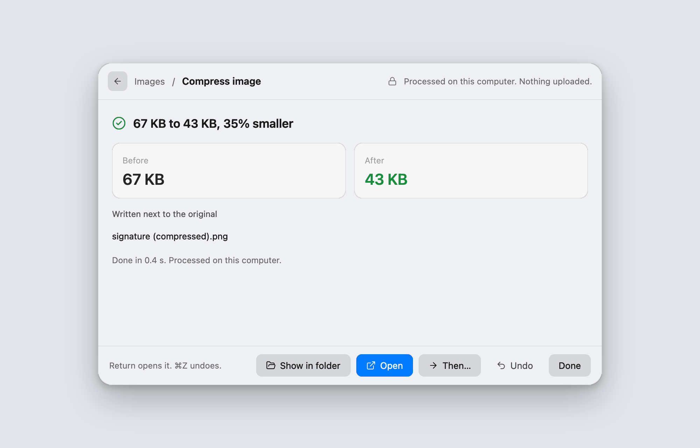
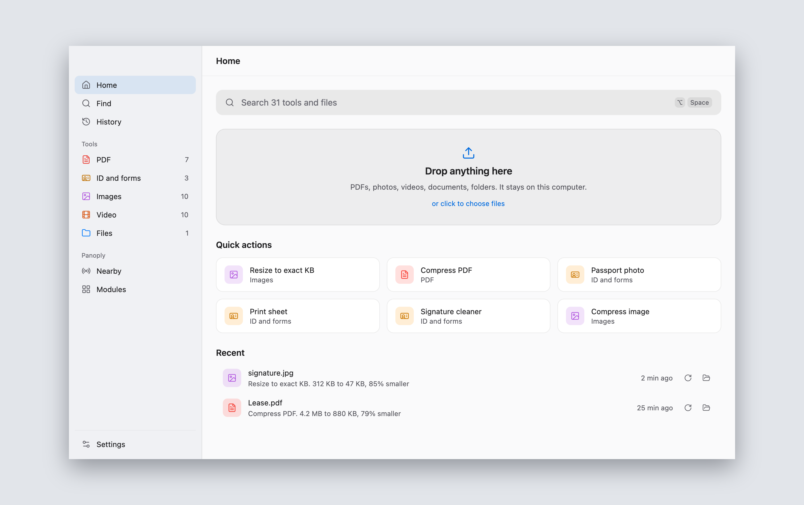
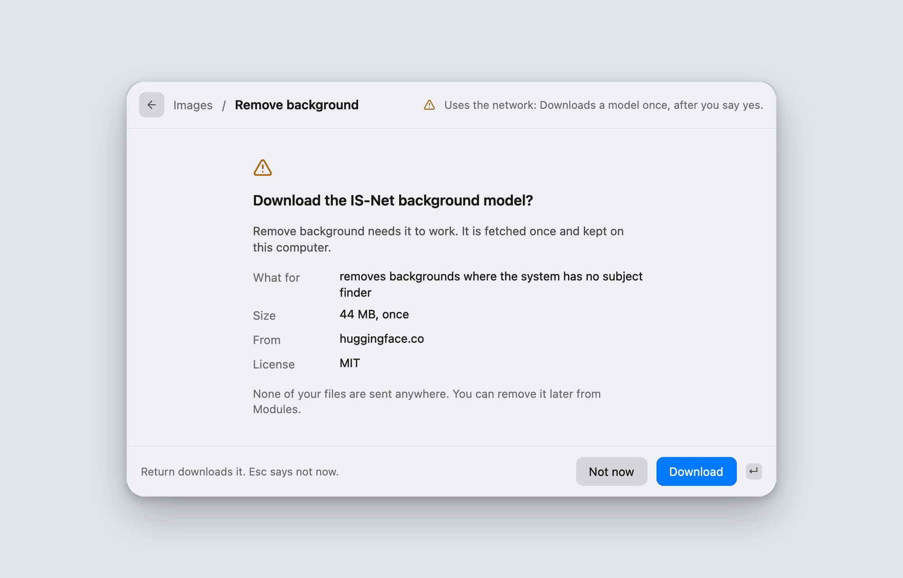

<p align="center">
  <picture>
    <source media="(prefers-color-scheme: dark)" srcset="docs/assets/panoply-logo-dark.svg">
    
  </picture>
</p>

<h3 align="center">Every file utility, in one open-source app.<br>It runs on your device and nothing is uploaded.</h3>

<p align="center">
  <a href="https://github.com/anzal1/panoply/actions/workflows/ci.yml"></a>
  <a href="https://github.com/anzal1/panoply/releases"></a>
  <a href="#license"></a>
  
</p>

<table align="center">
  <tr>
    <td align="center" valign="top" width="240">
      <a href="https://github.com/anzal1/panoply/releases/download/v0.1.0-beta/Panoply-0.1.0-beta-macos-arm64.dmg"></a>
      <br><sub><a href="https://github.com/anzal1/panoply/releases/download/v0.1.0-beta/Panoply-0.1.0-beta-macos-arm64.dmg">Apple silicon</a> &middot; <a href="https://github.com/anzal1/panoply/releases/download/v0.1.0-beta/Panoply-0.1.0-beta-macos-x64.dmg">Intel</a></sub>
    </td>
    <td align="center" valign="top" width="240">
      <a href="https://github.com/anzal1/panoply/releases/download/v0.1.0-beta/Panoply-0.1.0-beta-windows-x64.msi"></a>
      <br><sub><a href="https://github.com/anzal1/panoply/releases/download/v0.1.0-beta/Panoply-0.1.0-beta-windows-x64.msi">x64</a> &middot; <a href="https://github.com/anzal1/panoply/releases/download/v0.1.0-beta/Panoply-0.1.0-beta-windows-arm64.msi">arm64</a></sub>
    </td>
    <td align="center" valign="top" width="240">
      <a href="https://github.com/anzal1/panoply/releases/download/v0.1.0-beta/Panoply-0.1.0-beta-linux-x64.AppImage"></a>
      <br><sub><a href="https://github.com/anzal1/panoply/releases/download/v0.1.0-beta/Panoply-0.1.0-beta-linux-x64.AppImage">x64</a> &middot; <a href="https://github.com/anzal1/panoply/releases/download/v0.1.0-beta/Panoply-0.1.0-beta-linux-arm64.AppImage">arm64</a></sub>
    </td>
  </tr>
</table>

<p align="center"><sub>v0.1.0 beta &middot; <a href="https://github.com/anzal1/panoply/releases/tag/v0.1.0-beta">all downloads and SHA256SUMS</a> &middot; <a href="CHANGELOG.md">changelog</a></sub></p>

<p align="center">
  <picture>
    <source media="(prefers-color-scheme: dark)" srcset="docs/assets/panoply-demo-dark.gif">
    
  </picture>
</p>

## Why Panoply

- **One app, not a dozen.** The paid apps and upload sites you use one task at a time become one shortcut.
- **Your files stay on your device.** No account, no upload, no limits, no watermarks.
- **Say what you want.** Drop a file, type "make this under 50 kb", press Return.
- **Nothing is overwritten.** Every result is a new file next to the original, and Undo removes it.

## How it feels

<table>
  <tr>
    <td width="33%" valign="top">
      <picture>
        <source media="(prefers-color-scheme: dark)" srcset="docs/assets/screens/bar-words-dark.png">
        
      </picture>
      <br><b>Say it in plain words</b>
      <br><sub>"Under 50 kb" becomes a size target. The bar shows what it understood before it runs.</sub>
    </td>
    <td width="33%" valign="top">
      <picture>
        <source media="(prefers-color-scheme: dark)" srcset="docs/assets/screens/bar-running-dark.png">
        
      </picture>
      <br><b>Watch it work</b>
      <br><sub>Jobs run off the interface thread, show real progress and cancel at once.</sub>
    </td>
    <td width="33%" valign="top">
      <picture>
        <source media="(prefers-color-scheme: dark)" srcset="docs/assets/screens/bar-result-dark.png">
        
      </picture>
      <br><b>See what changed</b>
      <br><sub>Before and after numbers, the new file's name, and Undo.</sub>
    </td>
  </tr>
</table>

## What is in it

<table>
  <tr>
    <td width="50%" valign="top">
      <b>PDF</b> &nbsp;<sub>6 tools</sub><br>
      Merge, split, organize pages, compress to a quality or a size, images to PDF, PDF to images.<br><br>
      A 300 MB PDF compresses to 137 MB in 5 seconds, using 11 MB of memory.
    </td>
    <td width="50%" valign="top">
      <b>Images</b> &nbsp;<sub>9 tools</sub><br>
      Convert, compress, resize, strip metadata. Remove a background, erase an object, remove a watermark from your own pictures, upscale 4x.<br><br>
      Compress holds picture similarity at 0.97 and made 13 test photos 44.8% smaller.
    </td>
  </tr>
  <tr>
    <td valign="top">
      <b>ID and forms</b> &nbsp;<sub>3 tools, 15 exam presets</sub><br>
      Passport and visa photos, print sheets, a signature cleaner, and resize to an exact size in KB for a form or an exam portal.<br><br>
      840 test cases across the presets, none outside the published size window.
    </td>
    <td valign="top">
      <b>Video and audio</b> &nbsp;<sub>10 tools</sub><br>
      Convert, trim, compress to a size or an upload limit, extract audio, normalize loudness, stereo to mono, HDR to SDR, repair, inspect, edit streams.<br><br>
      A 4.6 GB, 73 minute video trims at keyframes in 0.96 seconds, using 73 MB of memory.
    </td>
  </tr>
  <tr>
    <td valign="top">
      <b>Text from images</b> &nbsp;<sub>2 tools</sub><br>
      Copy the text out of a picture, or turn a scanned PDF into a searchable one. Apple Vision on macOS, on-device models for English, Latin and Devanagari scripts elsewhere.<br><br>
      English reads at under 0.2% character error. Hindi reads at about 2%.
    </td>
    <td valign="top">
      <b>Share</b><br>
      Send and receive files with LocalSend apps on your own network, or make a QR link for a device with no app. From the command line today.<br><br>
      Only addresses on your own network are accepted.
    </td>
  </tr>
  <tr>
    <td valign="top">
      <b>Command bar</b><br>
      Opens from a hotkey anywhere: <kbd>Option</kbd> <kbd>Space</kbd> on macOS, <kbd>Ctrl</kbd> <kbd>Alt</kbd> <kbd>Space</kbd> on Windows and Linux. Searches every tool, takes dropped files and understands plain requests.<br><br>
      31 tools, one keystroke away.
    </td>
    <td valign="top">
      <b>For developers and agents</b><br>
      Every tool is also a command: <code>panoply run image.compress photo.jpg</code>. A community tool is a manifest plus a WebAssembly file that runs in a sandbox with no network.<br><br>
      498 jobs over real files through the app's own path, 0 failures.
    </td>
  </tr>
</table>

<sub>Measured on an Apple M5 Max. Each figure comes from a report with its method and reproduction steps in <a href="docs/research/">docs/research</a>.</sub>

<p align="center">
  <picture>
    <source media="(prefers-color-scheme: dark)" srcset="docs/assets/screens/app-home-dark.png">
    
  </picture>
  <br><sub>The app window, for when you want to browse. Same tools, same panels.</sub>
</p>

## Private by design

Your files are read and written on your own machine. There is no account, no sign-in, no telemetry and no cloud.

- **Never leaves your device:** your files, their names, their contents, usage statistics and crash reports.
- **Models and engines ask first.** A few tools need a model or an engine that is not in the installer, such as the 44 MB background model or the 28 MB erase model. Panoply names the item, its size, where it comes from and its license, and downloads nothing until you press Download. Each file is pinned to a release and checked against a SHA-256 before it is used.
- **Sharing is opt in.** It only runs when you start it, and only talks to your own network.

<p align="center">
  <picture>
    <source media="(prefers-color-scheme: dark)" srcset="docs/assets/screens/bar-consent-dark.png">
    
  </picture>
</p>

Every download, every network path and how each was checked: [docs/PRIVACY.md](docs/PRIVACY.md).

## Install

Download the file for your system from the [releases page](https://github.com/anzal1/panoply/releases/tag/v0.1.0-beta) and check it against `SHA256SUMS`. The beta is not code signed, so macOS and Windows ask you to confirm the first start, once.

<details>
<summary><b>macOS</b> (Apple silicon and Intel)</summary>

<br>

1. Open the `.dmg` and drag Panoply to Applications.
2. Double-click Panoply. macOS says it cannot check the app. Click Done.
3. Open System Settings, then Privacy and Security. Next to "Panoply was blocked to protect your Mac", click Open Anyway and confirm.

On macOS 14 and earlier, right-click Panoply and choose Open instead. Video tools use an `ffmpeg` on your Mac: `brew install ffmpeg`.

</details>

<details>
<summary><b>Windows</b> 10 and 11 (x64 and arm64)</summary>

<br>

1. Run the `.msi`, or unzip the `.zip` and start `panoply-desktop.exe`.
2. If SmartScreen shows "Windows protected your PC", click More info, then Run anyway.

The installer adds an Explorer entry, "Open with Panoply", and puts `panoply` on your PATH.

</details>

<details>
<summary><b>Linux</b> (x64 and arm64)</summary>

<br>

```bash
chmod +x Panoply-0.1.0-beta-linux-x64.AppImage
./Panoply-0.1.0-beta-linux-x64.AppImage
```

If it does not start, add `--appimage-extract-and-run`. The `.tar.gz` holds the same files and an `install.sh`.

</details>

<details>
<summary><b>First open</b></summary>

<br>

1. Start Panoply. The app window opens and a small command bar waits in the background.
2. Press the hotkey from anywhere. Set your own with `PANOPLY_HOTKEY="ctrl+alt+p"`.
3. Drop a file on the bar, or type: "compress pdf", "make this under 50 kb", "remove background".
4. Pick a tool, set the one or two options it shows, press Return. The new file lands next to the original.

</details>

What differs per system, and the steps for every first-open prompt, are in [docs/KNOWN-LIMITATIONS.md](docs/KNOWN-LIMITATIONS.md).

## Build from source

```bash
cargo build --release -p panoply-cli -p panoply-desktop
cargo run -p panoply-cli -- modules
cargo test --workspace
```

The toolchain is pinned in `rust-toolchain.toml`. Linux needs the libraries listed in [apps/desktop/packaging/README.md](apps/desktop/packaging/README.md). The desktop app's own checks, including the offscreen renders used for the images above, are in [apps/desktop/README.md](apps/desktop/README.md).

## Documentation

[docs/README.md](docs/README.md) is the index: vision, architecture, the spec of every tool, decisions, privacy and every measured result.

## Contributing

Start with [CONTRIBUTING.md](CONTRIBUTING.md). Every tool meets the budgets, beats a named quality bar, uses only permissive licenses and never copies code from tools it studies. To add a tool, copy [modules/template-rust](modules/template-rust).

## License

Dual licensed under [MIT](LICENSE-MIT) or [Apache-2.0](LICENSE-APACHE), at your option.

<p align="center"><sub>Built by the people, for the people.</sub></p>
