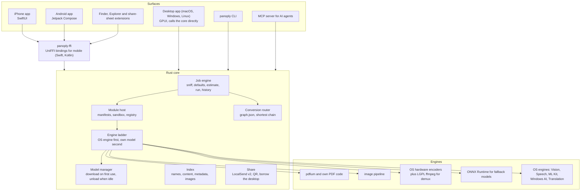
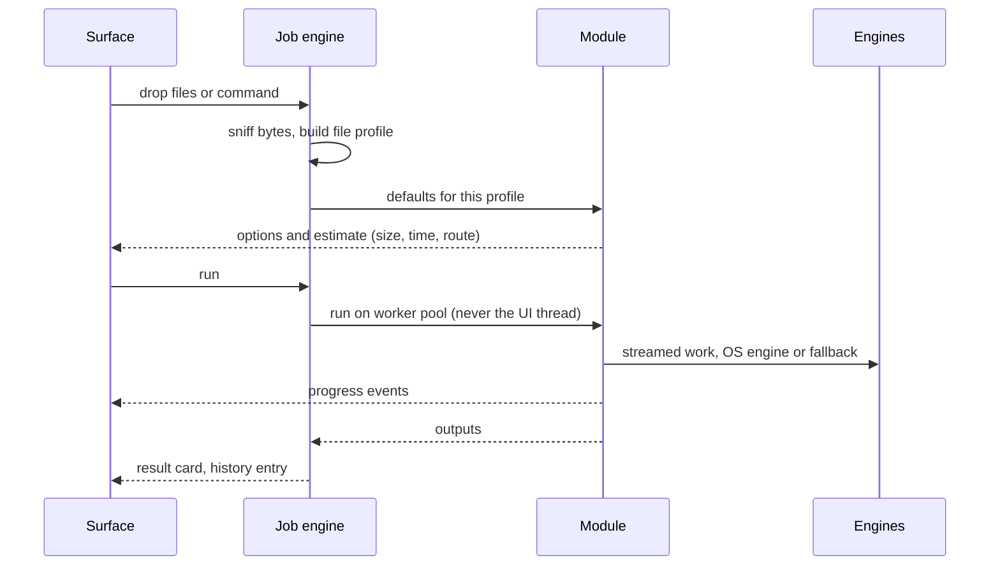

# Panoply architecture

Panoply is one Rust core with a native UI on each platform. Every tool is a
module that declares what it needs, and the core runs it. This document is
the map. The why behind each big choice is in [adr/](adr/), and the
per-module behavior is in [specs/](specs/).

The four rules every part is judged by (see [VISION.md](VISION.md)):
blazing fast, bang on utility, lowest possible memory, butter smooth.

## 1. The shape

Every surface reaches the same core, so a module written once appears in the
bar, the app window, the right-click menu, the share sheet, the CLI and MCP.

## 2. Repository layout

| Path | What lives there |
|---|---|
| `crates/panoply-core` | Job model, file sniffing, output naming, cancellation, budgets |
| `crates/panoply-manifest` | `module.toml` schema and validation |
| `crates/panoply-host` | Module trait, registry, capability guard, built-in modules |
| `crates/panoply-wasm` | Community module runtime: wasmtime, the WIT interface (`wit/module.wit`), sandbox limits |
| `crates/panoply-convert` | Conversion graph loader and router |
| `crates/panoply-pdf` | PDF engine: merge, split, organize, images to PDF, PDF to images, compress, the searchable-PDF text layer |
| `crates/panoply-image` | Image engine: the decode, color and resample pipeline behind convert, compress, resize, resize to exact KB and strip metadata |
| `crates/panoply-media` | Video and audio engine: convert, trim, compress, extract audio, normalize, mono, HDR to SDR, repair, inspect, streams |
| `crates/panoply-vision` | Image AI on small ONNX models, OS engines first: remove background, erase, remove watermark, upscale |
| `crates/panoply-ocr` | OCR engine ladder (OS engine, then PP-OCRv5, then Tesseract) with word boxes |
| `crates/panoply-id` | Passport and visa photo, print sheet and signature cleaner |
| `crates/panoply-share` | LocalSend v2 send and receive, and the QR browser page |
| `crates/panoply-platform-macos` | ImageIO, CoreImage and Vision behind a safe API: HEIC, HEIF, AVIF, camera RAW, system OCR and cutouts |
| `crates/panoply-smoke` | The smoke matrix: every module over real corpus files through the path the desktop app takes |
| `crates/panoply-bench` | The budget harness: start time, first preview, CPU and peak memory per module |
| `crates/panoply-cli` | The `panoply` command |
| `crates/panoply-mcp` | MCP tool definitions generated from manifests (the transport is not served yet) |
| `crates/panoply-ffi` | UniFFI bindings for the Android and iOS apps (not started) |
| `conversions/formats.py` | Source of truth for formats and converters; generates `docs/CONVERSIONS.md` and `crates/panoply-convert/data/graph.json` |
| `modules/` | Module manifests: built-in examples, `template-rust/` (start here to write a module), `examples-wasm/` (finished community modules) |
| `apps/desktop` | The GPUI desktop app for macOS, Windows and Linux, built directly on the Rust core |
| `packaging/`, `tools/` | Release scripts and package manifests, maintenance scripts |
| `tests/corpus/` | The real files the engines and the smoke matrix are measured on |
| `docs/` | Vision, architecture, flows, modules, decisions, plan, specs, research |
| `prototypes/` | Kill-test code that informed decisions (not shipped) |

## 3. Modules

A module is a manifest plus code.

- **Manifest (`module.toml`).** Declares the flow pattern (A to I, see
  [FLOWS.md](FLOWS.md)), accepted inputs, outputs, typed options with
  defaults, capabilities (files, network, models) and surfaces. The host
  validates it. A model with an unclean license or network access without a
  stated reason fails validation.
- **Built-in modules** are native Rust in `panoply-host` for full speed.
- **Community modules** compile to WebAssembly and run sandboxed: wasmtime on
  desktop and Android, an interpreter on iOS (no JIT allowed there). The
  interface is `crates/panoply-wasm/wit/module.wit`: a module exports `run` and
  can call only the host imports (read a chosen file by handle, write a new
  output the host names, progress, cancelled). No file system, no network, 256
  MB of memory, instant cancel, nothing resident between jobs. Heavy
  work never happens inside the sandbox; modules call host-provided engines
  (PDF, image, media, OCR) through imports, so a ten-line module runs at full
  native speed.
- **Capabilities.** A module sees only the files the user handed it and the
  output folder. Network is off unless the manifest asks with a reason and the
  user allows it. This makes "nothing leaves your device" provable for
  community code.
- **No module draws its own UI.** Each platform has one native component set
  (file input, number, choice, toggle, size, text, before and after preview
  for images, PDF pages, video frames and waveforms, result card). The app
  renders any manifest with it, so every module looks first-party and
  quality cannot drift.

## 4. Job lifecycle

- **Sniffing** reads magic bytes, never trusts extensions.
- **Profile** (pages, faces, GPS, codec, resolution, loudness) drives smart
  defaults per file.
- **Estimate before run**: size, dimensions, duration, route.
- **Outputs never overwrite.** `name (compressed).pdf` next to the original,
  or a chosen folder. Overwrite is explicit and sends the original to Trash.
- **Cancellation** is instant and leaves no partial files.
- **Errors** are plain language with a next step.

## 5. Conversion router

`conversions/formats.py` defines 214 formats in 20 families and the bridges
between families. It generates `graph.json`, which `panoply-convert` loads.
A request is routed by breadth-first search over plain converter steps, at
most four steps. Steps that need a model (transcription, OCR, read aloud) are
only taken as a single direct step, never chained. Only sensible family pairs
count, which yields 9,214 conversions. See [CONVERSIONS.md](CONVERSIONS.md).

## 6. Engine ladder and models

For every job that needs acceleration or ML, the ladder is:

1. **The OS engine** if present and it passes the module's quality bar:
   Apple Vision, Speech, Translation and NaturalLanguage; Android ML Kit;
   Windows AI APIs; VideoToolbox, MediaCodec, Media Foundation, VA-API.
2. **Our own small model** where the OS has nothing or falls short. Picked
   for size and a clean license ([research/tiny-models.md](research/tiny-models.md)),
   run with ONNX Runtime, downloaded only when the module is first used,
   checksum verified, size shown before download, loaded per job and unloaded
   after 60 seconds idle.
3. **No bundled language model.** Text-smart features use the OS model
   (Apple Foundation Models, Gemini Nano, Phi Silica), else the user's own
   local model or key, else they stay hidden. See ADR 0003.

The choice is per platform and decided in CI by the quality bar test, not by
opinion.

## 7. Memory and speed by design

- **Streaming everywhere.** PDFs page by page, images in bands or tiles, media
  through hardware pipelines with constant memory regardless of length.
- **Idle means idle.** No background CPU when nothing runs; the window is
  pre-created hidden so showing it is instant.
- **UI thread rule.** No task over 4 ms on it. All work runs on a worker pool
  with a CPU budget.
- **Budgets are tests.** The CI harness measures idle CPU, module start
  (under 50 ms), first preview (under 100 ms), frame rate (120 fps), and peak
  memory per job (under 300 MB for documents and images, flat for media).
  A module that misses one does not ship. Numbers are in
  [FLOWS.md](FLOWS.md#budgets-every-module-must-meet).
- **Measured baseline.** In the shell kill test (`prototypes/shell-test`) the
  GPUI bar idled at 33 MB with a 152 to 190 ms cold start, next to SwiftUI at
  30 MB and 182 ms.
- **Measured on the beta.** The smoke matrix ran every module over real files
  through the app's own path: 498 jobs, 0 failures
  ([research/beta-smoke.md](research/beta-smoke.md)).

## 8. Sharing between devices

- **Protocol:** LocalSend v2, so Panoply interoperates with LocalSend's
  existing apps on every platform. Discovery over multicast and mDNS,
  transfers over HTTPS with certificate fingerprints.
- **Devices without Panoply:** a QR code opens a page served by the sender on
  the local network with a one-time token.
- **Borrow the desktop:** a phone sends a job spec and inputs to the user's own
  computer, which runs it and returns the result. Same channel, same trust.
- **Clipboard sync** over the same paired, encrypted link.
- **No servers.** Far-away transfer is a community module, not core.

## 9. Find (the index)

- File system events keep the index fresh: FSEvents on macOS, the USN journal
  on Windows, fanotify or inotify on Linux.
- Names in a memory-mapped table, full text in tantivy, metadata in SQLite.
- OCR text and image embeddings are computed in the background only within a
  CPU and battery budget, and only for folders the user includes.
- Plain-words queries ("photos taken in Goa in December") parse into filters.

## 10. Security and privacy

- Every parser is fuzzed; hostile files must never crash the app or run code.
- Modules are sandboxed with explicit capabilities.
- Model and engine downloads are pinned by checksum.
- Anything that touches the network is labelled before it runs.
- Reverse engineering of other tools is clean-room only (ADR 0005).

## 11. Platforms

The three desktops launched together in v0.1.0-beta (2026-10-14), then Android,
then iOS ([ADR 0001](adr/0001-native-ui-per-platform.md) and
[ADR 0009](adr/0009-platform-order.md)).

| Platform | UI | Status |
|---|---|---|
| macOS | GPUI (one desktop app), native Swift only for Finder and share extensions | Released in v0.1.0-beta. The most tested system |
| Windows | the same GPUI desktop app | Released in v0.1.0-beta |
| Linux | the same GPUI desktop app | Released in v0.1.0-beta |
| CLI | Rust, all desktops | Released in v0.1.0-beta |
| MCP server | Rust, all desktops | Tool definitions exist, the transport is not shipped yet |
| Android | Jetpack Compose | Next |
| iOS | SwiftUI | After Android |
