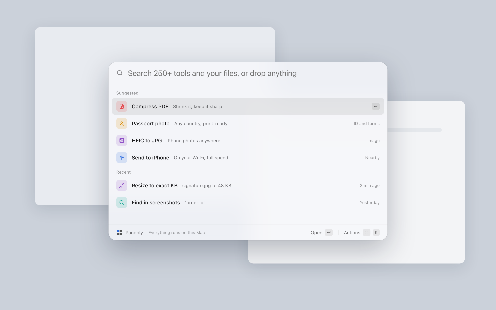
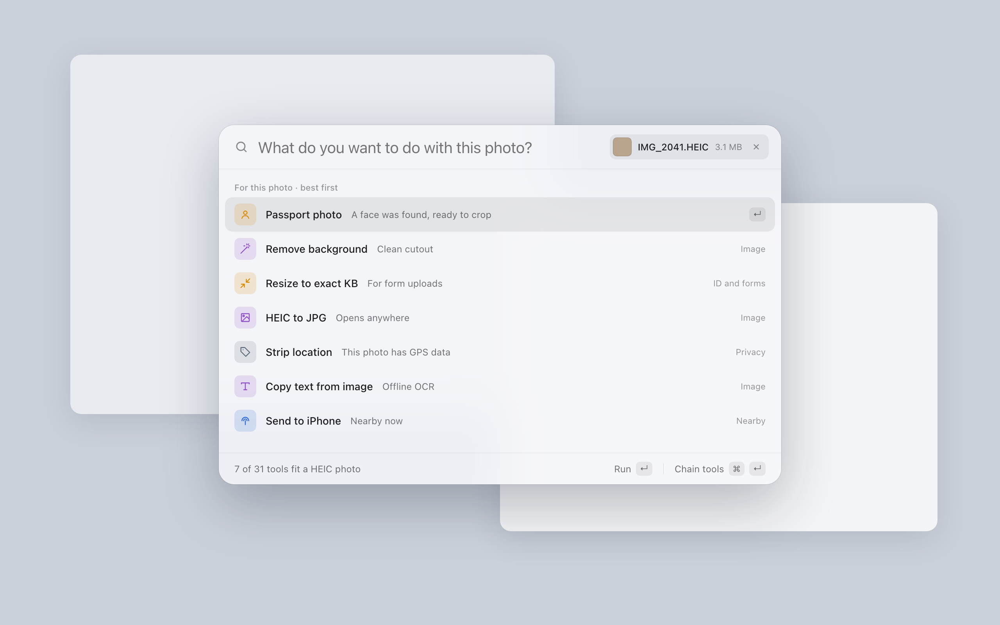
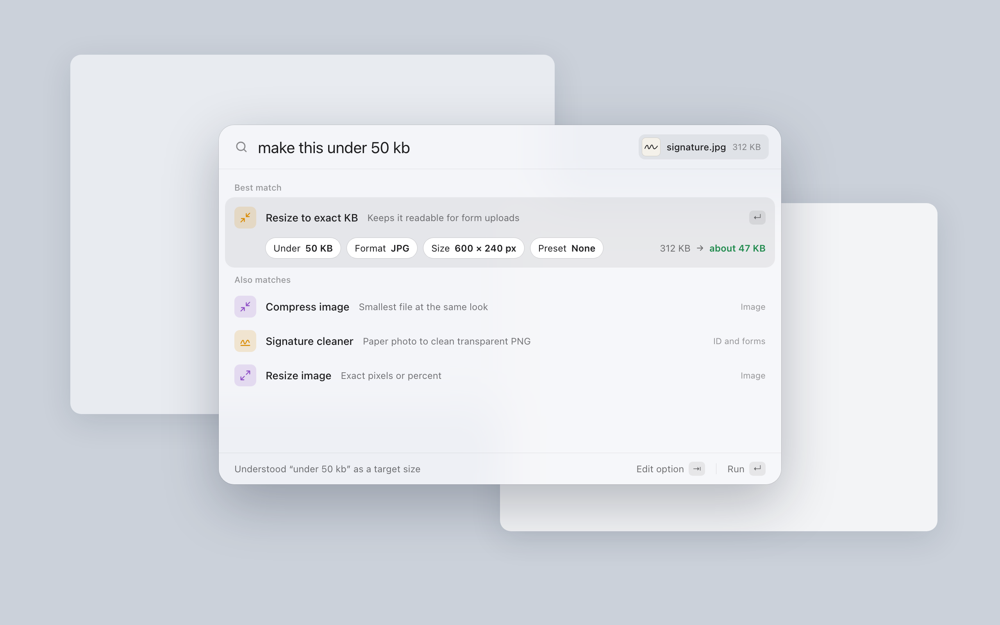
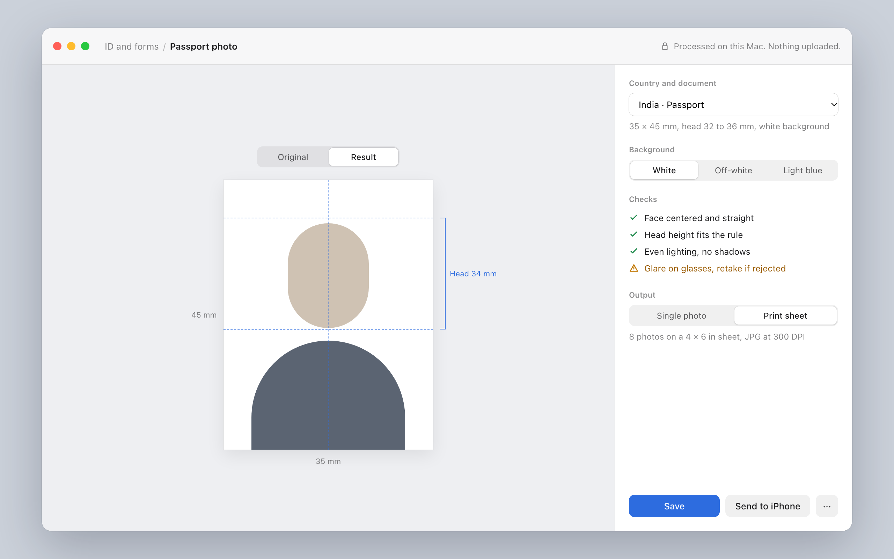
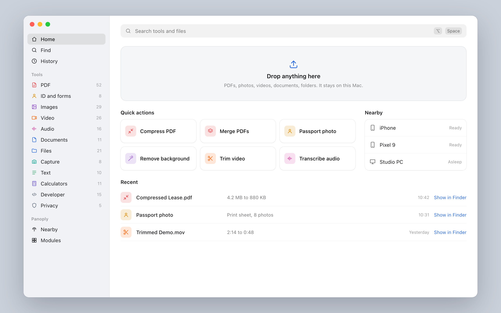
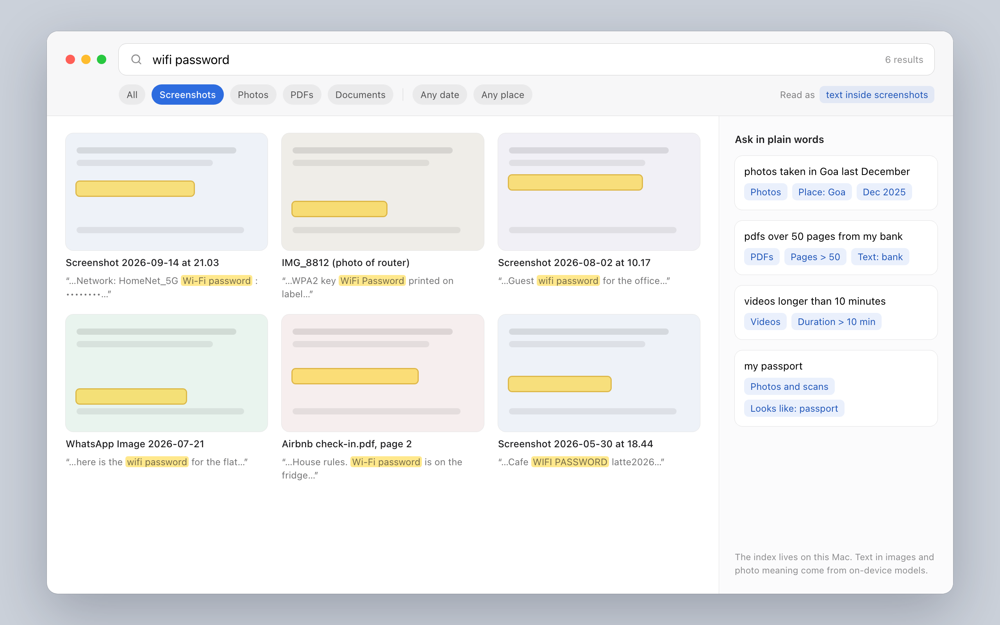
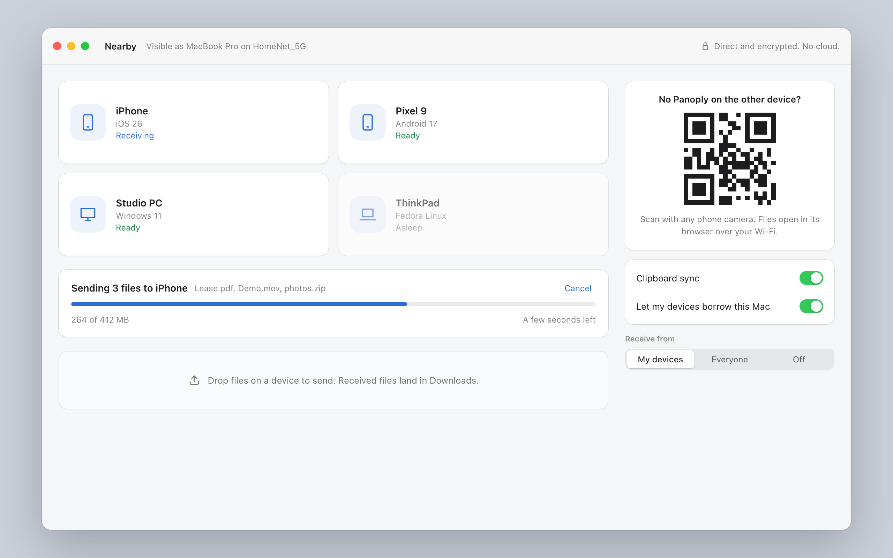
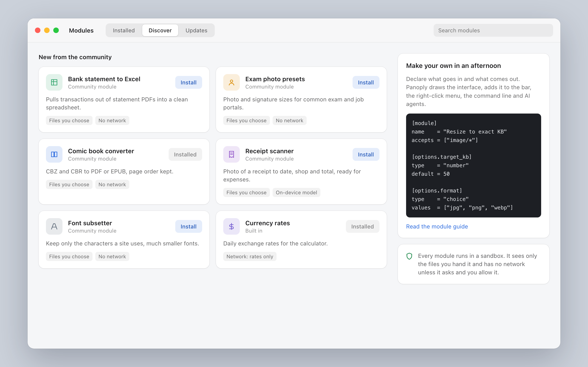
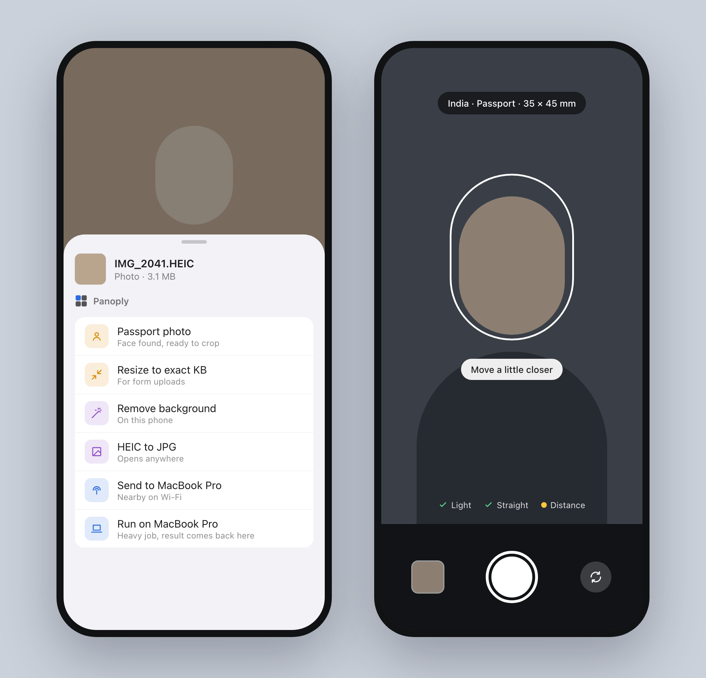

# Wireframes

The nine key screens of Panoply, light mode. Each image is rendered from the
source in [wireframes/src/](wireframes/src/). Open any `.dc.html` file there in
a browser to see it live; `support.js` renders it without any build step.

To re-render the images after editing a source file (macOS, Chrome installed):

```bash
cd docs/wireframes
"/Applications/Google Chrome.app/Contents/MacOS/Google Chrome" --headless=new \
  --hide-scrollbars --force-device-scale-factor=2 --window-size=1280,800 \
  --screenshot="$PWD/01-main.png" "file://$PWD/src/Main.dc.html"
```

Sizes per screen are in `src/canvas.json`.

## The bar: one shortcut, every tool

**1. Command bar at rest.** Glass panel, suggested and recent tools, keyboard
first, "Everything runs on this Mac".



**2. A file dropped on the bar.** Tools that fit this file, ranked. A face was
found, so passport photo comes first; the GPS data is flagged.



**3. Say what you want.** "make this under 50 kb" becomes the right tool with
options filled in and the result estimated before running.



## The app: tools, home and search

**4. A tool: passport photo.** Live preview with head guides, country rule,
background, automatic checks, print sheet output.



**5. App window, home.** Every category with tool counts, drop anything, quick
actions, nearby devices, recent results.



**6. Find anything.** Text inside screenshots and photos, plain-words queries
turned into filters.



## Devices, modules and the phone

**7. Share between devices.** Devices on your network, transfers, a QR code for
devices without Panoply, clipboard sync, borrow this Mac.



**8. Modules, by the people.** Community modules with permission badges, and how
small a module manifest is.



**9. Phone.** Share sheet with Panoply actions, including running a heavy job on
your computer, and the passport camera with live checks.


