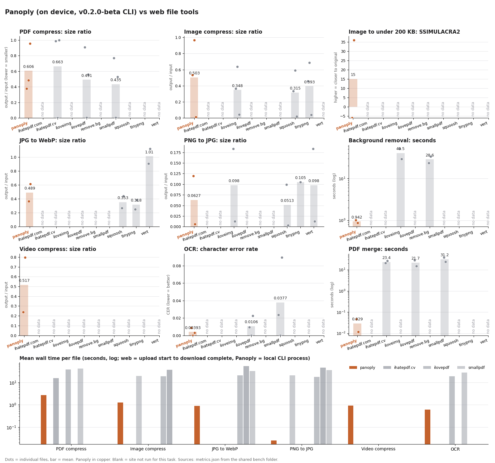

# Panoply v0.2.0-beta against popular web file tools

Run on 2026-10-17 on one MacBook (Apple M5 Max, macOS 26.6.2). This is a partial run: it was cut short by a launch deadline, so
several sites and tasks are marked "not tested". Nothing below is extrapolated.

## Summary

Where Panoply wins (measured here):
- OCR: lowest or tied-lowest character error rate on all three scans (CER 0.30% and 0.88% on the two real book pages, 0% on the generated one)
  in 0.4 to 0.9 s. iLovePDF scored 2.25% and 0.94%, Smallpdf 8.93% and 2.38%, on the same pages. Panoply and Smallpdf kept the original page
  image; iLovePDF re-encoded it (render SSIM 0.89 to 0.94 against the input).
- Background removal at full size: 2400x3000 output in about 1 s. remove.bg's free download is 447x559 (its 2400x3000 "Max" is behind an Unlock button).
  iLoveIMG also returns full size, in 29 to 52 s.
- Merge: output about 0.6x the input size on pair A (140 pages), against 1.06x (iLovePDF) and 3.17x (Smallpdf); text identical, bookmarks kept per file.
- Speed: every Panoply run took 0.0 to 7.5 s. Web runs took 13 to 150 s (these include automation overhead, see Method).
- Local: Panoply is the only tool here that ran with no upload (see "Where the file goes").

Where Panoply loses (measured here):
- PDF compress size at default: irs-p17-2022.pdf went from 2,853 KB to 2,731 KB (0.96x). iLovePDF got 0.56x and Smallpdf 0.53x. On image-streams.pdf Panoply
  produced 1,403 KB, while iLovePDF produced 14 KB at render SSIM 0.998. The web results cost some fidelity in places (Smallpdf render SSIM min 0.84 on irs-p17), but
  they are far smaller. Panoply's default is the more conservative one.
- Default image compress is also conservative: antonelli.jpg 0.97x (SSIMULACRA2 86.6) against 0.59x to 0.68x for the web tools (70.3 to 77.2). These are not size-matched,
  so this shows a different trade-off, not a quality win. WebP conversion from JPEG is larger than TinyPNG and Squoosh (710 KB against 445 and 508 KB), at higher quality (62.8 against 56.2 and 56.7).
- Compress to 200 KB: Panoply hits the size but at poor quality (SSIMULACRA2 36.0 on the portrait, -6.1 on the 10179x1400 panorama). No competitor was tested on this task, so there is no comparison.
- PNG to JPG on the small photo: iLoveIMG and VERT score 94.9 at 27 KB, Panoply 90.5 at 18 KB (different size and quality point, not matched).
- Background-removal PNGs are large: 7.5 MB and 4.7 MB against 1.7 MB and 1.2 MB from iLoveIMG (palette PNG).

Not tested: video compression on any web site (CloudConvert and FreeConvert were not reached), ihatepdf.com beyond one failed compress, VERT video, and every 200 KB-target run on a web tool.

## Method

- Tool under test: `panoply-cli-0.2.0-beta-macos-arm64.tar.gz` from the GitHub release (sha256 77ea5f97...dfbf, matches SHA256SUMS). Run at `nice -n 15`, one process per file, defaults unless stated. No model or engine downloads were needed.
  Engines that ran: Apple Vision for OCR and cut-out, VideoToolbox HEVC for video (hardware, so its speed is not portable).
- Web sites: each used anonymously in Chrome (a fresh tab, no account, no card, cookie notices declined or closed). Each site's default or "recommended" setting was used. The input was set with the browser's file upload; outputs were downloaded and moved out of Downloads straight away.
- Inputs are public-domain or openly licensed files from Panoply's test corpus (`tests/corpus`): NASA astronaut portraits (antonelli, borman), an Internet Archive scan, IRS and qpdf test PDFs, Blender sample videos (CC-BY-3.0). No personal files were uploaded. File picks were fixed before running and no file was dropped after seeing results. Exact files and sha256 are below.
- Timing: Panoply is process wall time. Web time is from upload start until the file landed in Downloads, measured by file modification time. It includes clicking and screenshots driven through browser automation, so it overstates the site's own time by roughly 5 to 15 s per run, and more where a run needed a retry (noted per row). Web sites are not slower by exactly these numbers, but the gap is far larger than that overhead. Squoosh and VERT run in the browser, so their times are on this Mac.
- Quality measures (all computed locally, `docs/research/benchmark-vs-web/metrics.py`): images use SSIMULACRA2 (libjxl `ssimulacra2` from `brew install jpeg-xl` 0.12.0), plus SSIM and PSNR. Alpha is flattened on white, 16-bit is converted to 8-bit sRGB, and an output with a different size is resized to the input size before scoring.
  The 16-bit scoring cannot see loss of 16-bit precision. PDFs: pages rendered with `pdftoppm` at 100 DPI (up to 10 pages), mean and minimum SSIM against the original, `pdftotext` similarity, page count. Video: VMAF (ffmpeg 9.0.1 libvmaf, default model) against the input. OCR: character and word error rate against a ground-truth text, after collapsing white space. The labels for the two book pages were typed by the Panoply team (checked against the pages' own hidden OCR layer), so they are not independent; the pairwise CER between tools is also in the data. Merge: page sum, per-page text, outline, page sizes.
- Background removal: output size and alpha statistics only. I did not compare edges by eye in this run; previews were generated but not reviewed.
- One run per file and site. No variance is claimed.
- Poppler 26.08.0, tesseract 5.5.3 (installed, not used), Python 3.9.6 with pillow 11.3.0, numpy 2.0.2, scikit-image 0.24.0, pypdf 6.21.0, RapidFuzz 3.13.0, jiwer 4.0.0, matplotlib 3.9.4.

## Which sites were reached

| site | reached | tasks run | notes |
|---|---|---|---|
| Panoply 0.2.0-beta CLI | yes | all 9 | local |
| iLovePDF | yes | PDF compress, merge, OCR | recommended level. No video |
| iLoveIMG | yes | image compress, PNG to JPG, background removal | no target-size option; WebP target not offered by the converter I used (convert-from-JPG page returned 404; not further probed) |
| Smallpdf | yes | PDF compress, merge, OCR | Basic level (free). Moderate and Strong carry a crown (Pro). No image or video tools |
| ihatepdf.cv | yes | PDF compress, merge | not tested: OCR. The site has a target-file-size mode, not tested |
| ihatepdf.com | partly | PDF compress failed | the tab froze for more than 150 s on irs-p17 (Recommended level), no output; abandoned. Other tasks not tested |
| TinyPNG | yes | image compress, JPG to WebP, PNG to JPG | free: 20 images, 5 MB each, 3 conversions per session |
| remove.bg | yes | background removal | free download is the preview size. Site banner says the standalone site closes on 1 December 2026 (moving to Canva) |
| Squoosh | yes | image compress, JPG to WebP, PNG to JPG | no automatic size target, only a quality slider |
| VERT | yes | JPG to WebP, PNG to JPG | converter only |
| CloudConvert, FreeConvert | no | none | not tested (time) |

## Where the file goes

| site | evidence |
|---|---|
| iLovePDF, iLoveIMG | uploaded to `api26.ilovepdf.com/v1/upload` (seen in the page's resource timings); the site says files are deleted after 2 hours |
| Smallpdf | uploaded to `files.smallpdf.com` and Cloudflare R2 storage (resource timings), tasks on `task.smallpdf.com` |
| TinyPNG | server-side (the image is optimised remotely; upload endpoint not captured). Site shows ads |
| remove.bg | server-side; the page cites Canva's terms on upload |
| ihatepdf.cv | site statement only: runs in the browser, nothing uploaded. Not verified by network capture |
| ihatepdf.com | site statement: "Browser mode" or server (deleted within an hour). Mode used not determined |
| Squoosh | in the browser. Resource timings showed only squoosh.app and google-analytics |
| VERT | site statement: in the browser. Not verified |
| Panoply | local process |

## Limits and walls hit

- Smallpdf: the free tier gave us 3 compress, 2 merge and 3 OCR runs with no wall, but only the Basic level. The pre-run size estimate was far off the result (irs-p17: promised about 74% saved, got 47%; ia-scan: promised about 985 kB, got 2,914 KB).
- iLovePDF: the "100% smaller" label on image-streams.pdf (2.83 MB to 14 KB) is real output; render SSIM is 0.998.
- TinyPNG: `rgba-16bit.png` to JPEG showed "Failed". Conversion is limited to 3 images per session.
- remove.bg: only the 447x559 preview is free.
- ihatepdf.cv: returned the original bytes unchanged for irs-p17-2022.pdf (2,853 KB in and out). Its own text says a file is never returned larger.
- No CAPTCHA or bot check was met on any site. No account, payment or credential was used.

## Results

Panoply is first within each input. "s" is seconds, see Method for what that means on web sites. Rows with status skipped (a site has no such tool) are listed at the end.

### pdf-compress

| input | site | status | s | out | ratio | pages | text kept | render SSIM | render SSIM min |
|---|---|---|---|---|---|---|---|---|---|
| ia-scan-public-lands.pdf | panoply | ok | 7.5 | 1,433 KB | 0.38 | 76>76 | 1.000 | 0.9989 | 0.9971 |
| ia-scan-public-lands.pdf | ilovepdf | ok | 60.6 | 3,438 KB | 0.91 | 76>76 | 1.000 | 0.9924 | 0.9548 |
| ia-scan-public-lands.pdf | smallpdf | ok | 61.0 | 2,914 KB | 0.77 | 76>76 | 1.000 | 0.9999 | 0.9997 |
| ia-scan-public-lands.pdf | ihatepdf.cv | ok | 12.9 | 3,739 KB | 0.99 | 76>76 | 1.000 | 1.0000 | 1.0000 |
| image-streams.pdf | panoply | ok | 0.0 | 1,403 KB | 0.48 | 9>9 | 1.000 | 1.0000 | 1.0000 |
| image-streams.pdf | ilovepdf | ok | 14.9 | 14 KB | 0.00 | 9>9 | 1.000 | 0.9976 | 0.9972 |
| image-streams.pdf | smallpdf | ok | 26.6 | 16 KB | 0.01 | 9>9 | 1.000 | 0.9822 | 0.9604 |
| image-streams.pdf | ihatepdf.cv | ok | 14.1 | 3 KB | 0.00 | 9>9 | 1.000 | 0.9648 | 0.8728 |
| irs-p17-2022.pdf | panoply | ok | 0.6 | 2,731 KB | 0.96 | 138>138 | 1.000 | 1.0000 | 1.0000 |
| irs-p17-2022.pdf | ilovepdf | ok | 36.6 | 1,600 KB | 0.56 | 138>138 | 0.998 | 0.9964 | 0.9906 |
| irs-p17-2022.pdf | smallpdf | ok | 36.5 | 1,510 KB | 0.53 | 138>138 | 0.998 | 0.9767 | 0.8393 |
| irs-p17-2022.pdf | ihatepdf.cv | ok | 19.0 | 2,853 KB | 1.00 | 138>138 | 1.000 | 1.0000 | 1.0000 |
| irs-p17-2022.pdf | ihatepdf.com | failed | 150.0 |  |  |  |  |  |  |

### img-compress

| input | site | status | s | out | ratio | WxH | SSIMULACRA2 | SSIM | PSNR dB |
|---|---|---|---|---|---|---|---|---|---|
| an-teallach-panorama.jpg | panoply | ok | 2.4 | 1,800 KB | 0.53 | 10179x1400 | 79.1 | 0.962 | 39.4 |
| an-teallach-panorama.jpg | iloveimg | ok | 17.1 | 1,238 KB | 0.37 | 10179x1400 | 73.6 | 0.947 | 37.8 |
| an-teallach-panorama.jpg | tinypng | ok | 53.8 | 1,543 KB | 0.46 | 10179x1400 | 74.9 | 0.953 | 38.3 |
| an-teallach-panorama.jpg | squoosh | ok | 16.8 | 1,126 KB | 0.33 | 10179x1400 | 71.8 | 0.941 | 37.3 |
| antonelli.jpg | panoply | ok | 1.0 | 1,119 KB | 0.97 | 2400x3000 | 86.6 | 0.961 | 40.0 |
| antonelli.jpg | iloveimg | ok | 27.1 | 735 KB | 0.63 | 2400x3000 | 77.2 | 0.934 | 37.6 |
| antonelli.jpg | tinypng | ok | 32.8 | 793 KB | 0.68 | 2400x3000 | 70.3 | 0.951 | 39.3 |
| antonelli.jpg | squoosh | ok | 17.8 | 685 KB | 0.59 | 2400x3000 | 74.2 | 0.927 | 37.1 |
| rgba-16bit.png | panoply | ok | 0.3 | 25 KB | 0.01 | 1024x512 | 100.0 | 1.000 | inf |
| rgba-16bit.png | iloveimg | ok | 14.8 | 100 KB | 0.04 | 1024x512 | 61.3 | 0.706 | 33.2 |
| rgba-16bit.png | tinypng | ok | 24.5 | 94 KB | 0.04 | 1024x512 | 62.4 | 0.757 | 34.4 |
| rgba-16bit.png | squoosh | ok | 22.0 | 47 KB | 0.02 | 1024x512 | 100.0 | 1.000 | n/a |

### img-compress-200kb

| input | site | status | s | out | ratio | WxH | SSIMULACRA2 | SSIM | PSNR dB |
|---|---|---|---|---|---|---|---|---|---|
| an-teallach-panorama.jpg | panoply | ok | 3.0 | 193 KB | 0.06 | 10179x1400 | -6.1 | 0.802 | 30.7 |
| antonelli.jpg | panoply | ok | 1.6 | 195 KB | 0.17 | 2400x3000 | 36.0 | 0.785 | 32.9 |

### jpg-to-webp

| input | site | status | s | out | ratio | WxH | SSIMULACRA2 | SSIM | PSNR dB |
|---|---|---|---|---|---|---|---|---|---|
| an-teallach-panorama.jpg | panoply | ok | 1.1 | 1,234 KB | 0.36 | 10179x1400 | 67.1 | 0.947 | 38.0 |
| an-teallach-panorama.jpg | tinypng | ok | 53.6 | 851 KB | 0.25 | 10179x1400 | 59.8 | 0.930 | 36.3 |
| an-teallach-panorama.jpg | squoosh | ok | 16.4 | 908 KB | 0.27 | 10179x1400 | 60.7 | 0.932 | 36.6 |
| an-teallach-panorama.jpg | vert | ok | 25.1 | 3,059 KB | 0.90 | 10179x1400 | 84.0 | 0.984 | 44.0 |
| antonelli.jpg | panoply | ok | 0.6 | 710 KB | 0.61 | 2400x3000 | 62.8 | 0.909 | 36.8 |
| antonelli.jpg | tinypng | ok | 53.6 | 445 KB | 0.38 | 2400x3000 | 56.2 | 0.867 | 34.9 |
| antonelli.jpg | squoosh | ok | 25.0 | 508 KB | 0.44 | 2400x3000 | 56.7 | 0.875 | 35.2 |
| antonelli.jpg | vert | ok | 39.9 | 1,293 KB | 1.12 | 2400x3000 | 82.4 | 0.964 | 40.4 |

### png-to-jpg

| input | site | status | s | out | ratio | WxH | SSIMULACRA2 | SSIM | PSNR dB |
|---|---|---|---|---|---|---|---|---|---|
| paris-icc-exif-xmp.png | panoply | ok | 0.0 | 18 KB | 0.12 | 403x302 | 90.5 | 0.988 | 43.1 |
| paris-icc-exif-xmp.png | iloveimg | ok | 25.3 | 27 KB | 0.18 | 403x302 | 94.9 | 0.999 | 52.7 |
| paris-icc-exif-xmp.png | tinypng | ok | 45.0 | 16 KB | 0.11 | 403x302 | 90.1 | 0.998 | 48.7 |
| paris-icc-exif-xmp.png | squoosh | ok | 21.5 | 15 KB | 0.10 | 403x302 | 80.1 | 0.982 | 39.8 |
| paris-icc-exif-xmp.png | vert | ok | 30.1 | 27 KB | 0.18 | 403x302 | 94.9 | 0.999 | 52.7 |
| rgba-16bit.png | panoply | ok | 0.0 | 13 KB | 0.01 | 1024x512 | 84.9 | 0.991 | 48.9 |
| rgba-16bit.png | iloveimg | ok | 15.6 | 30 KB | 0.01 | 1024x512 | 88.1 | 0.992 | 49.8 |
| rgba-16bit.png | tinypng | failed |  |  |  |  |  |  |  |
| rgba-16bit.png | squoosh | ok | 13.6 | 8 KB | 0.00 | 1024x512 | 23.9 | 0.933 | 18.0 |
| rgba-16bit.png | vert | ok | 40.0 | 30 KB | 0.01 | 1024x512 | 26.1 | 0.937 | 18.0 |

### bg-remove

| input | site | status | s | out | WxH | same size as input | alpha>0 coverage | semi-transparent px |
|---|---|---|---|---|---|---|---|---|
| antonelli.jpg | panoply | ok | 1.0 | 7,495 KB | 2400x3000 | True | 0.525 | 0.012 |
| antonelli.jpg | iloveimg | ok | 51.6 | 1,743 KB | 2400x3000 | True | 0.522 | 0.213 |
| antonelli.jpg | remove.bg | ok | 23.6 | 313 KB | 447x559 | False | 0.586 | 0.010 |
| borman.jpg | panoply | ok | 0.9 | 4,682 KB | 2400x3000 | True | 0.443 | 0.011 |
| borman.jpg | iloveimg | ok | 29.4 | 1,203 KB | 2400x3000 | True | 0.391 | 0.248 |
| borman.jpg | remove.bg | ok | 33.5 | 220 KB | 447x559 | False | 0.439 | 0.010 |

### video-compress

| input | site | status | s | out | ratio | VMAF | VMAF min |
|---|---|---|---|---|---|---|---|
| sintel-720p-h264-10s.mp4 | panoply | ok | 0.7 | 1,218 KB | 0.24 | 95.7 | 75.8 |
| sintel-trailer-480p.mp4 | panoply | ok | 1.2 | 3,397 KB | 0.80 | 90.3 | 54.0 |

### ocr

| input | site | status | s | out | CER | WER | orig image kept | render SSIM |
|---|---|---|---|---|---|---|---|---|
| scan-claims-p9.pdf | panoply | ok | 0.6 | 475 KB | 0.0088 | 0.0407 | likely (image bytes within 10% of input) | 1.0000 |
| scan-claims-p9.pdf | ilovepdf | ok | 15.4 | 960 KB | 0.0094 | 0.0444 | re-encoded or recompressed | 0.8922 |
| scan-claims-p9.pdf | smallpdf | ok | 27.8 | 503 KB | 0.0238 | 0.0889 | likely (image bytes within 10% of input) | 1.0000 |
| scan-en1.pdf | panoply | ok | 0.4 | 78 KB | 0.0000 | 0.0000 | likely (image bytes within 10% of input) | 1.0000 |
| scan-en1.pdf | ilovepdf | ok | 12.7 | 172 KB | 0.0000 | 0.0000 | re-encoded or recompressed | 0.9425 |
| scan-en1.pdf | smallpdf | ok | 27.3 | 87 KB | 0.0000 | 0.0000 | likely (image bytes within 10% of input) | 1.0000 |
| scan-lands-p15.pdf | panoply | ok | 0.9 | 846 KB | 0.0030 | 0.0247 | likely (image bytes within 10% of input) | 1.0000 |
| scan-lands-p15.pdf | ilovepdf | ok | 29.0 | 1,289 KB | 0.0225 | 0.0569 | re-encoded or recompressed | 0.9017 |
| scan-lands-p15.pdf | smallpdf | ok | 26.4 | 890 KB | 0.0893 | 0.1423 | likely (image bytes within 10% of input) | 1.0000 |

### pdf-merge

| input | site | status | s | out | size vs inputs | pages | text sim | outline entries | page sizes kept |
|---|---|---|---|---|---|---|---|---|---|
| pair A | panoply | ok | 0.0 | 1,879 KB | 0.63 | 140 (sum ok: True) | 1.000 | 3 | True |
| pair A | ilovepdf | ok | 28.5 | 3,182 KB | 1.06 | 140 (sum ok: True) | 1.000 | 18 | True |
| pair A | smallpdf | ok | 38.3 | 9,540 KB | 3.17 | 140 (sum ok: True) | 0.999 | 18 | True |
| pair A | ihatepdf.cv | ok | 20.8 | 1,902 KB | 0.63 | 140 (sum ok: True) | 1.000 | 0 | True |
| pair B | panoply | ok | 0.0 | 93 KB | 0.92 | 31 (sum ok: True) | 1.000 | 3 | True |
| pair B | ilovepdf | ok | 14.9 | n/a | n/a | None (sum ok: None) | n/a | None | None |
| pair B | smallpdf | ok | 24.1 | 104 KB | 1.02 | 31 (sum ok: True) | 1.000 | 3 | True |
| pair B | ihatepdf.cv | ok | 25.9 | 93 KB | 0.92 | 31 (sum ok: True) | 1.000 | 0 | True |

### Not run (the site has no such tool, or the option does not exist)

- iLoveIMG: 200 KB target, JPG to WebP (see above), video. iLovePDF: video, images. Smallpdf: every image and video task and background removal. TinyPNG: 200 KB target, PDF tasks. Squoosh: 200 KB target (manual quality slider only), PDF, OCR, video. All web sites: video compression (not tested).
- iLovePDF merge pair B was downloaded (101 KB, in `iLovePDF` outputs) but the scorer failed on that row, so it has no metrics here.

## Reproduction

1. `git clone https://github.com/anzal1/panoply && cd panoply`, fetch the corpus: `python3 tests/corpus/fetch.py` (public-domain and openly licensed files, pinned by sha256).
2. Download `panoply-cli-0.2.0-beta-macos-arm64.tar.gz` from the v0.2.0-beta release and check it against `SHA256SUMS`.
3. Build the inputs folder as listed below (copy the files, rasterise the three OCR scans, no text layer: `pdftoppm -r 300 -jpeg` of `ia-scan-public-lands.pdf` page 15 and `ia-scan-mining-claims.pdf` page 9, plus `crates/panoply-ocr/testdata/labelled/en-1-scan.png`, each wrapped into a one-page PDF with Pillow at 300 DPI). The ground-truth texts are in `crates/panoply-ocr/testdata/labelled/`.
4. `python3 -I docs/research/benchmark-vs-web/run_panoply.py` runs every Panoply task and logs to `runs.jsonl`.
5. For each web site, upload the same files with default settings and append a line to `runs.jsonl` per run (site, task, input, output, seconds, status, notes).
6. `python3 -I docs/research/benchmark-vs-web/collect.py` computes the metrics, `make_tables.py` prints these tables, `make_chart.py` redraws the summary. Scripts expect a venv with pillow, numpy, scikit-image, pypdf, rapidfuzz, jiwer, matplotlib, and `ssimulacra2`, `ffmpeg` with libvmaf, and poppler on PATH. The bench folder path is set at the top of `metrics.py`.

Bench outputs are not committed.

## Exact files (sha256, paths relative to the bench inputs folder)

| file | sha256 |
|---|---|
| img/an-teallach-panorama.jpg | ec2a7983a37e47ac021bdd539bae8e4713e405b5e456746eb1149a31090645be |
| img/antonelli.jpg | 4df83631506b64f914b62c40f6cab4f64f328ee7b10e6a885ccb341165e2abe3 |
| img/borman.jpg | 96cea7aeb0a0d32a7ccb009490c263f8384bd6e2fe480d7bfdc28581b55017be |
| img/paris-icc-exif-xmp.png | 308bb51c3338ed9519cdaaa79186b934a21d1748d94120ed0348eb4f193d0988 |
| img/rgba-16bit.png | 8644ba9494512b45e591f0e040879b6e258645abdc9a338a7cc136b651d9293c |
| labels/corpus-ia-claims-p9.txt | dd0857f9fa99d11006dfae56a2cf9ab28d38c30c7b57099dc13d0a9975f07283 |
| labels/corpus-ia-lands-p15.txt | f497c9cd26a9e0f68ef59aa6a71921ad42fb021bd969093de463db8eeb08c072 |
| labels/en-1-scan.txt | 585c9789fa2b8e25cacdeb5a2b5a67438535fd78bb4f8a54cd1ed657a7dc4963 |
| merge/a1-irs-f1040-2022.pdf | 7f7933e17b2701e8555164f18bd9d93e8891c7bc0d6e45d8df6d84a2cf78b48f |
| merge/a2-irs-p17-2022.pdf | 9e7b040385b5433fece6be86d8a6c298222dcbbccf0f2ad343484c330ac1b5ca |
| merge/b1-linearized.pdf | 135cee6bd018c06d40c8c46c4a0230b2799adb90f502e214a347b3855039a24e |
| merge/b2-annotation-highlight.pdf | 72b6387356ccfdfb95a0a5eff5e1ceb9b7667019807d7b04abaf64dad7ea143a |
| ocr/scan-claims-p9.pdf | 58fda0a0ec7975f155edf00ad05fc60c65eb2dde22093e42e5a34a1636dfcd2e |
| ocr/scan-en1.pdf | 6baad74d57dece4b554f5b3417f29695bc17c7db401ceda95ed4034d23a56f7c |
| ocr/scan-lands-p15.pdf | 731e7fd73a76c2d300f61754071fbeb6b1d836cd9272808d509ea8c6a5f8363a |
| pdf/ia-scan-public-lands.pdf | d214c554d469db98b74cbde8ff05ff0f573cb61f8824359ed34acea0b117e2b7 |
| pdf/image-streams.pdf | d84a925580d8d336619d819edc5cdbf0fedcc9a87f64d145bca38411df0c69f1 |
| pdf/irs-p17-2022.pdf | 9e7b040385b5433fece6be86d8a6c298222dcbbccf0f2ad343484c330ac1b5ca |
| video/sintel-720p-h264-10s.mp4 | 52f127a6e77a8544c80ef635f82fc1098615af1a8fc38b2c5c1bd10a740a7ee8 |
| video/sintel-trailer-480p.mp4 | b670602fa00934ca27c4351bb0efe7ea7a07fae57284e44226025eeed7c51254 |

Sources: NASA portraits (public domain), Internet Archive scans on Wikimedia Commons (public domain), IRS publications (US federal work), qpdf and pdf.js test files (Apache-2.0), libavif sample PNG, a generated 16-bit RGBA PNG from the corpus generator, Blender sintel clips (CC-BY-3.0). See `tests/corpus/*.toml` for each file's license.
